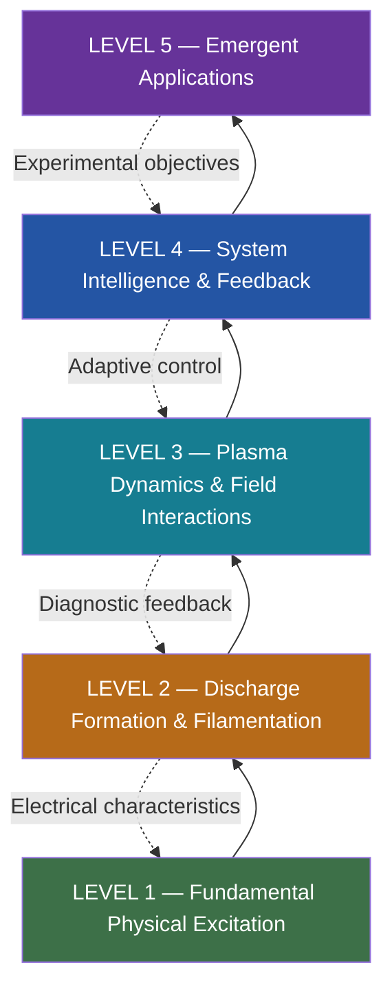
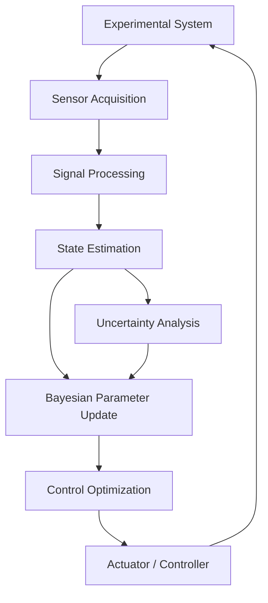
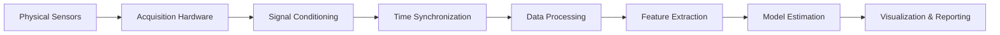

# ⚡ Plasma Dream-Web
### A Hierarchical Dream-Engineered System for Plasma Visualization, Bio-Stimulation, Environmental Remediation & Advanced Magnetohydrodynamic Applications

  <strong>THE INTERSECTION OF PLASMA PHYSICS, COMPUTATIONAL DREAM ENGINEERING & EMERGENT SYSTEM DESIGN</strong>

  <strong>Created by</strong>
   
  <a href="https://github.com/maxmarchione"><strong>Max Marchione</strong></a>
  &nbsp;·&nbsp;
  <a href="https://github.com/ole-lehmann"><strong>Ole Lehmann</strong></a>

  
  
  
  
  
  

  <em>Turning stochastic plasma phenomena into structured, measurable, and computationally interpretable physical systems.</em>

---

## Overview

**Plasma Dream-Web** is an open-source, five-level hierarchical plasma engineering framework designed to transform the stochastic behavior of dielectric barrier discharge (DBD) plasma filaments into a scientifically instrumented, visually interpretable, and computationally structured environment.

The project explores the intersection of:

- Non-equilibrium plasma physics
- Dielectric barrier discharge engineering
- Computational electromagnetic modeling
- Magnetohydrodynamic (MHD) levitation
- Lorentz force analysis
- Plasma-assisted surface modification
- Low-pressure argon plasma processing
- Excimer ultraviolet radiation
- Bio-stimulation and plasma-liquid interactions
- Environmental remediation
- Bayesian optimization and adaptive feedback control

Rather than treating plasma as a purely visual or electrical phenomenon, Plasma Dream-Web approaches it as a hierarchical physical system in which electrical excitation, electron kinetics, filament formation, electromagnetic interactions, and emergent behavior can be analyzed as interconnected processes.

The ultimate objective is to establish a modular prototyping environment where plasma behavior can be observed, modeled, manipulated, and evaluated across multiple physical and computational scales.

### v2.2 Additions

- Full argon plasma application framework, including low-pressure excimer UV, sterilization research, and surface activation.
- Detailed MHD levitation engineering, incorporating Lorentz force analysis, Earnshaw stability considerations, and active Bayesian feedback control.
- Seven distinct physical prototype configurations with high-fidelity engineering schematics.
- Three novel emergent application proposals.
- Expanded hierarchical architecture for connecting physical plasma processes with computational visualization.
- Extended research direction covering plasma-mediated bio-stimulation and environmental remediation.

---

## Table of Contents

- [Core Philosophy](#core-philosophy)
- [System Architecture](#system-architecture)
- [Five-Level Hierarchical Model](#five-level-hierarchical-model)
- [Dielectric Barrier Discharge Engineering](#dielectric-barrier-discharge-dbd-engineering)
- [Plasma Physics & Mathematical Foundations](#plasma-physics--mathematical-foundations)
- [Argon Plasma Applications](#argon-plasma-applications)
- [Magnetohydrodynamic Levitation](#magnetohydrodynamic-mhd-levitation)
- [Bayesian Feedback Control](#bayesian-feedback-control)
- [Seven Physical Prototypes](#seven-physical-prototypes)
- [Three Emergent Application Proposals](#three-emergent-application-proposals)
- [Computational Modeling](#computational-modeling)
- [Instrumentation & Diagnostics](#instrumentation--diagnostics)
- [Safety Architecture](#safety-architecture)
- [Research Roadmap](#research-roadmap)
- [Technical Glossary](#technical-glossary)
- [Contributing](#contributing)
- [License](#license)

---

# Core Philosophy

Traditional plasma experiments frequently isolate individual phenomena: discharge ignition, filament propagation, electron excitation, ionization, or electromagnetic interaction.

Plasma Dream-Web proposes a more interconnected approach.

The system treats plasma as a dynamic, multiscale environment in which macroscopic electrical behavior emerges from microscopic particle interactions.

Its core design principles are:

**1. Hierarchical Physical Modeling**

Every observable phenomenon should be traceable to its underlying physical mechanism, from applied electrical excitation to localized plasma filament formation.

**2. Computational Observability**

Physical plasma behavior should be translated into structured data that can be analyzed, visualized, compared, and modeled.

**3. Modular Experimental Architecture**

Individual prototypes should be independently configurable while remaining compatible with the broader system architecture.

**4. Adaptive Optimization**

Experimental parameters should be refined through measurement-driven feedback rather than relying exclusively on fixed operating configurations.

**5. Emergent Application Development**

The framework should support applications beyond conventional plasma generation, including surface engineering, environmental treatment, bio-stimulation research, and electromagnetic levitation.

---

# System Architecture

Plasma Dream-Web is organized around five interconnected hierarchical levels.

The architecture separates fundamental physical processes from higher-level system behavior, allowing each layer to be independently investigated.

## Five-Level Hierarchical Model

### Level 1 — Fundamental Physical Excitation

The foundational layer concerns the electrical and physical conditions required to establish a discharge.

Primary variables include:

- Applied voltage
- Electric field intensity
- Excitation frequency
- Displacement current
- Dielectric permittivity
- Electrode geometry
- Gas composition
- Pressure and temperature
- Breakdown conditions

The primary objective is to characterize the relationship between electrical excitation and the onset of ionization.

### Level 2 — Discharge Formation & Filamentation

This layer examines the formation and evolution of dielectric barrier discharge structures.

DBD systems produce spatially and temporally localized microdischarges. Their behavior depends on electrode geometry, dielectric characteristics, applied waveform, gas composition, and discharge conditions.

Research variables include:

- Microdischarge initiation
- Filament morphology
- Discharge propagation
- Surface charge accumulation
- Dielectric charging and relaxation
- Localized electron excitation
- Temporal discharge distributions

The objective is to characterize the stochastic structure of plasma filaments and their relationship to the underlying electrical system.

### Level 3 — Plasma Dynamics & Field Interactions

The third layer examines plasma behavior as a coupled electromagnetic system.

Relevant phenomena include:

- Electron-neutral collisions
- Ion transport
- Charged-particle drift
- Plasma conductivity
- Electromagnetic field distributions
- Charge separation
- Plasma-liquid interactions
- Magnetically influenced transport

This layer establishes the connection between localized discharge phenomena and larger-scale physical interactions.

### Level 4 — System Intelligence & Feedback

The fourth layer introduces computational instrumentation and adaptive control.

Instead of relying on static operating assumptions, the framework incorporates a measurement-driven control architecture.

Potential components include:

- Real-time diagnostic acquisition
- Signal processing
- Parameter estimation
- Bayesian optimization
- Anomaly detection
- Experimental state estimation
- Feedback stabilization
- Uncertainty quantification

The goal is to establish a continuously updated representation of the experimental system.

### Level 5 — Emergent Applications

The highest layer concerns the application of the underlying plasma architecture.

Research directions include:

- Plasma-assisted sterilization
- Low-pressure argon plasma processing
- Excimer ultraviolet applications
- Surface activation
- Plasma-mediated bio-stimulation
- Environmental remediation
- MHD levitation
- Novel electromagnetic manipulation systems

This layer converts the capabilities of the lower levels into application-oriented research.

---

# Dielectric Barrier Discharge (DBD) Engineering

Dielectric barrier discharge is the principal plasma-generation architecture explored by Plasma Dream-Web.

A conventional DBD configuration consists of two electrodes separated by a gas-filled discharge region, with at least one dielectric barrier preventing the formation of an unrestricted continuous discharge.

The dielectric barrier limits transferred charge and helps distribute discharge activity into localized microdischarges.

## Physical Mechanism

The general discharge process involves:

1. Application of an alternating or pulsed electrical potential.
2. Establishment of an electric field across the discharge region.
3. Electron acceleration and collisional ionization.
4. Formation of localized microdischarge channels.
5. Accumulation of surface charge on the dielectric.
6. Modification of the local electric field.
7. Termination or redistribution of individual discharge events.
8. Repetition during subsequent excitation cycles.

This produces a dynamic plasma environment containing spatially distributed discharge structures.

## Key Engineering Parameters

| Parameter | Engineering relevance |
|---|---|
| Applied voltage | Determines electrical excitation |
| Frequency | Influences discharge timing |
| Dielectric constant | Influences field distribution |
| Dielectric thickness | Influences capacitive coupling |
| Electrode geometry | Determines field concentration |
| Gas composition | Influences ionization and reaction pathways |
| Pressure | Influences collision frequency and breakdown |
| Gap geometry | Influences discharge characteristics |
| Surface charge | Influences local field suppression |
| Temperature | Influences gas and discharge properties |

## Equivalent Electrical Model

A simplified DBD electrical model can be represented as a combination of dielectric and plasma-region capacitances.

\[
C_d = \frac{\epsilon_0 \epsilon_r A}{d}
\]

Where:

- \(C_d\): Dielectric capacitance
- \(\epsilon_0\): Vacuum permittivity
- \(\epsilon_r\): Relative dielectric permittivity
- \(A\): Effective electrode area
- \(d\): Dielectric thickness

The overall circuit must account for the nonlinear and time-dependent behavior of the discharge region.

A more complete model incorporates plasma conductivity, transient microdischarge currents, and dielectric surface charging.

---

# Plasma Physics & Mathematical Foundations

Plasma Dream-Web is grounded in established plasma physics and electromagnetic theory.

The following equations provide a foundation for computational modeling and experimental interpretation.

## 1. Lorentz Force

The Lorentz force describes the interaction between charged particles and electromagnetic fields.

\[
\mathbf{F}=q(\mathbf{E}+\mathbf{v}\times\mathbf{B})
\]

Where:

- \(q\): Particle charge
- \(\mathbf{E}\): Electric field
- \(\mathbf{v}\): Particle velocity
- \(\mathbf{B}\): Magnetic flux density

This relationship is particularly relevant to charged-particle dynamics and electromagnetic confinement.

## 2. Maxwell's Equations

The electromagnetic behavior of the system is described by Maxwell's equations.

\[
\nabla \cdot \mathbf{E}=\frac{\rho}{\epsilon_0}
\]

\[
\nabla \cdot \mathbf{B}=0
\]

\[
\nabla \times \mathbf{E}
=-\frac{\partial \mathbf{B}}{\partial t}
\]

\[
\nabla \times \mathbf{B}
=\mu_0\mathbf{J}
+\mu_0\epsilon_0\frac{\partial\mathbf{E}}{\partial t}
\]

These equations establish the relationship between electric fields, magnetic fields, charge density, and current density.

## 3. Plasma Frequency

The electron plasma frequency describes the characteristic natural oscillation frequency of electrons relative to the comparatively stationary ion background.

\[
\omega_{pe}=
\sqrt{\frac{n_e e^2}{\epsilon_0 m_e}}
\]

Where:

- \(n_e\): Electron number density
- \(e\): Elementary charge
- \(m_e\): Electron mass

The corresponding frequency is:

\[
f_{pe}=\frac{\omega_{pe}}{2\pi}
\]

## 4. Debye Length

The Debye length describes the characteristic distance over which electrostatic potential disturbances are screened in a plasma.

\[
\lambda_D=
\sqrt{\frac{\epsilon_0 k_B T_e}
{n_e e^2}}
\]

This quantity is relevant to plasma quasi-neutrality and the spatial organization of charged-particle interactions.

## 5. Magnetohydrodynamic Force Density

For a conducting medium, the magnetic contribution to the force density can be expressed as:

\[
\mathbf{f}_B=\mathbf{J}\times\mathbf{B}
\]

Where:

- \(\mathbf{J}\): Current density
- \(\mathbf{B}\): Magnetic flux density

The relationship is central to MHD analysis, although the validity of a fluid approximation depends on the plasma's collisionality and characteristic length and timescales.

## 6. Energy Conservation

The Poynting theorem provides a framework for understanding electromagnetic energy transfer.

\[
\frac{\partial u}{\partial t}
+\nabla\cdot\mathbf{S}
=-\mathbf{J}\cdot\mathbf{E}
\]

Where:

- \(u\): Electromagnetic energy density
- \(\mathbf{S}\): Poynting vector
- \(\mathbf{J}\): Current density
- \(\mathbf{E}\): Electric field

This provides a useful basis for analyzing energy transfer between the excitation system and plasma.

---

# Argon Plasma Applications

Version 2.2 introduces a dedicated argon plasma application framework.

Argon is a noble gas frequently used in plasma processing because of its relatively well-characterized atomic structure, inert chemical behavior under many conditions, and suitability for controlled discharge experiments.

The proposed research directions include three principal application categories.

## 1. Low-Pressure Excimer UV

Excimer and exciplex systems involve electronically excited species that can emit ultraviolet radiation during transitions to lower-energy states.

Argon excimer research is particularly relevant to vacuum-ultraviolet emission associated with excited argon dimers.

The framework considers:

- Excited-state population dynamics
- Electron-impact excitation
- Collisional de-excitation
- Radiative transitions
- Pressure-dependent emission
- Spectral characterization
- Optical diagnostics

A key research objective is to investigate how pressure, excitation conditions, and gas composition influence the production and characterization of ultraviolet emission.

## 2. Plasma-Assisted Sterilization

Plasma-assisted sterilization is an emerging research direction involving multiple potentially active mechanisms.

These can include:

- Reactive oxygen species
- Reactive nitrogen species
- UV or VUV radiation
- Charged-particle interactions
- Localized surface chemistry
- Oxidative damage to biological structures

An argon discharge may also produce reactive species through interactions with residual gases, oxygen, water vapor, or treated surfaces.

The framework proposes controlled evaluation of plasma exposure conditions, surface compatibility, microbial reduction, and material degradation.

**Important:** Sterilization performance must be independently established through validated microbiological testing. Plasma exposure alone does not establish sterilization.

## 3. Plasma Surface Activation

Plasma surface activation investigates modifications to surface chemistry and wettability.

Potential mechanisms include:

- Removal of organic contamination
- Modification of surface functional groups
- Changes in surface energy
- Improved adhesion
- Changes in contact angle
- Surface oxidation under appropriate gas conditions

Potential application areas include polymers, engineered materials, coatings, and surface preparation.

---

# Magnetohydrodynamic (MHD) Levitation

One of the most technically ambitious components introduced in v2.2 is the investigation of magnetohydrodynamic levitation.

The research examines the possibility of manipulating conductive media and magnetically responsive systems through controlled electromagnetic forces.

## Fundamental Principle

The Lorentz force density is expressed as:

\[
\mathbf{f}=\mathbf{J}\times\mathbf{B}
\]

A conducting medium exposed to an appropriately configured magnetic field can experience a volumetric electromagnetic force.

The magnitude and direction depend on the current distribution and magnetic field geometry.

For a simplified perpendicular configuration:

\[
|\mathbf{f}|=|\mathbf{J}||\mathbf{B}|
\]

## Engineering Considerations

The MHD subsystem requires analysis of:

- Magnetic field topology
- Current density distribution
- Electrode configuration
- Conductivity
- Fluid density
- Viscosity
- Thermal loading
- Electromagnetic coupling
- Mechanical constraints
- Force balance

The objective is to characterize the conditions under which electromagnetic forces can meaningfully counteract gravitational or other mechanical forces.

## Earnshaw Stability Analysis

Earnshaw's theorem establishes important limitations on stable static equilibrium in certain conservative inverse-square force systems.

It is particularly relevant when evaluating passive magnetic confinement and levitation arrangements.

However, it should not be interpreted as a universal prohibition on magnetic levitation.

Stable configurations may involve:

- Active feedback control
- Diamagnetic materials
- Superconducting flux pinning
- Dynamic stabilization
- Nonlinear force configurations
- Mechanical or electromagnetic constraints

Plasma Dream-Web incorporates Earnshaw stability considerations as an engineering constraint rather than assuming that a static magnetic field automatically creates a stable levitation equilibrium.

## Active Levitation Feedback

The proposed active-control architecture evaluates deviations between the measured system state and the desired equilibrium.

\[
e(t)=x_{\text{target}}-x_{\text{measured}}(t)
\]

A controller can use this error to modify appropriate actuator inputs.

The system's actual response must be characterized experimentally, including latency, saturation, instability, and coupling between control channels.

---

# Bayesian Feedback Control

Plasma Dream-Web v2.2 introduces Bayesian feedback as a proposed mechanism for intelligent experimental optimization.

Conventional control systems frequently operate using predetermined parameters and known system dynamics.

However, plasma systems can exhibit nonlinear behavior, stochastic discharge events, changing material properties, and measurement uncertainty.

Bayesian methods offer a framework for updating system estimates as new experimental observations become available.

## Bayesian Parameter Estimation

Bayes' theorem:

\[
P(\theta|D)=
\frac{P(D|\theta)P(\theta)}{P(D)}
\]

Where:

- \(\theta\): Unknown system parameters
- \(D\): Experimental observations
- \(P(\theta)\): Prior distribution
- \(P(D|\theta)\): Likelihood
- \(P(\theta|D)\): Posterior distribution

Potential estimation targets include:

- Discharge onset characteristics
- Plasma response parameters
- Electrical impedance
- Magnetic field response
- Surface activation outcomes
- System stability indicators

## Closed-Loop Architecture

## Proposed Control Objectives

1. Estimate the current experimental state.
2. Identify deviations from the target operating condition.
3. Update the system's probabilistic parameter model.
4. Evaluate candidate control adjustments.
5. Apply permitted control changes.
6. Measure the resulting system response.
7. Repeat the estimation and optimization process.

The control architecture is intended to improve repeatability and provide a more rigorous understanding of system behavior.

---

# Seven Physical Prototypes

The v2.2 research program includes seven distinct physical prototype configurations supported by high-fidelity engineering schematics.

The following functional taxonomy describes the intended prototype areas and provides a framework for documenting their individual configurations.

| Prototype | Research focus | Primary engineering objective |
|---|---|---|
| P-01 | DBD Filament Chamber | Characterization of microdischarge formation |
| P-02 | Argon Plasma Chamber | Controlled low-pressure discharge research |
| P-03 | Excimer UV Module | UV/VUV emission characterization |
| P-04 | Plasma Surface Activation | Material surface modification |
| P-05 | Plasma Bio-Stimulation | Plasma-mediated biological interaction research |
| P-06 | MHD Levitation Platform | Electromagnetic force and stability analysis |
| P-07 | Adaptive Plasma Control | Bayesian feedback and experimental optimization |

*These are functional documentation categories, not independently verified descriptions of the seven original schematics.*

## P-01 — DBD Filament Chamber

Research objectives:

- Characterize discharge morphology.
- Observe microdischarge distribution.
- Investigate dielectric surface charging.
- Correlate electrical waveforms with optical observations.

## P-02 — Argon Plasma Chamber

Research objectives:

- Investigate low-pressure plasma behavior.
- Characterize gas-dependent discharge properties.
- Examine electron excitation and energy transfer.
- Establish reproducible diagnostic conditions.

## P-03 — Excimer UV Module

Research objectives:

- Investigate excited-state emission.
- Characterize spectral output.
- Evaluate pressure-dependent emission behavior.
- Examine optical coupling and radiation containment.

## P-04 — Plasma Surface Activation

Research objectives:

- Evaluate surface wettability.
- Characterize chemical surface modifications.
- Investigate treatment uniformity.
- Measure material compatibility.

## P-05 — Plasma Bio-Stimulation

Research objectives:

- Investigate plasma-liquid interactions.
- Characterize reactive-species generation.
- Examine dose-dependent biological responses.
- Establish appropriate biological controls.

## P-06 — MHD Levitation Platform

Research objectives:

- Characterize Lorentz force distributions.
- Evaluate electromagnetic force balance.
- Analyze stability conditions.
- Investigate active feedback requirements.

## P-07 — Adaptive Plasma Control

Research objectives:

- Integrate diagnostic instrumentation.
- Implement probabilistic parameter estimation.
- Investigate adaptive operating-point selection.
- Characterize repeatability and uncertainty.

---

# Three Emergent Application Proposals

Beyond the seven prototype configurations, v2.2 identifies three additional research directions.

## Proposal I — Plasma-Integrated Environmental Remediation

A modular plasma treatment framework for investigating the degradation or transformation of selected environmental contaminants.

Potential research mechanisms:

- Reactive oxygen species generation
- Reactive nitrogen chemistry
- Plasma-liquid interactions
- Oxidation pathways
- Contaminant transformation
- Reaction kinetics
- Post-treatment characterization

The proposed system would investigate how discharge characteristics and treatment conditions influence chemical transformation.

Key evaluation criteria:

- Contaminant concentration before and after treatment
- Reaction-product identification
- Energy consumption
- Treatment reproducibility
- Potential secondary pollutants

The goal is to explore plasma-assisted remediation as a potentially complementary environmental treatment technology.

## Proposal II — Plasma-Mediated Bio-Stimulation Interface

An experimental interface exploring interactions between non-equilibrium plasma, liquids, surfaces, and biological systems.

Research areas include:

- Plasma-generated reactive species
- Plasma-activated liquids
- Oxidative signaling pathways
- Exposure-dependent responses
- Cellular compatibility
- Dose-response characterization

A central research question is whether carefully characterized plasma-generated chemical environments can produce reproducible biological responses.

This proposal requires appropriate biological controls, validated exposure measurements, and independent safety evaluation before any therapeutic or clinical claims can be made.

## Proposal III — Adaptive Electromagnetic Levitation Network

An advanced MHD and electromagnetic control concept combining field measurements, force estimation, and adaptive feedback.

The proposed architecture would combine:

- Electromagnetic field characterization
- Lorentz force estimation
- Dynamic state estimation
- Stability analysis
- Bayesian optimization
- Multi-sensor feedback

The long-term objective is to investigate a modular electromagnetic manipulation environment in which field configurations and control parameters can be optimized based on observed system behavior.

---

# Computational Modeling

The computational component of Plasma Dream-Web is intended to bridge the gap between experimental observations and theoretical models.

A complete implementation can be organized around several numerical and analytical approaches.

## 1. Electrostatic Modeling

Solve for electric potential under appropriate boundary conditions.

\[
\nabla\cdot(\epsilon\nabla\phi)=-\rho
\]

Where:

- \(\phi\): Electric potential
- \(\epsilon\): Permittivity
- \(\rho\): Charge density

The electric field follows:

\[
\mathbf{E}=-\nabla\phi
\]

## 2. Particle Transport

Charged-particle transport can be investigated through drift-diffusion approximations where appropriate.

\[
\boldsymbol{\Gamma}_e
=-\mu_e n_e\mathbf{E}
-D_e\nabla n_e
\]

Where:

- \(\boldsymbol{\Gamma}_e\): Electron flux
- \(\mu_e\): Electron mobility
- \(n_e\): Electron density
- \(D_e\): Electron diffusion coefficient

More detailed models may require kinetic treatment using the Boltzmann equation or particle-in-cell methods.

## 3. Fluid Modeling

For fluid-like plasma approximations, conservation equations can describe mass, momentum, and energy transport.

The momentum equation may include:

- Pressure gradients
- Viscous forces
- Electromagnetic forces
- External body forces

The choice between fluid, kinetic, and hybrid approaches must depend on the physical regime being modeled.

## 4. Electromagnetic Simulation

Numerical electromagnetic models can be used to investigate:

- Field distributions
- Electrode geometry
- Magnetic field configurations
- Current density
- Electromagnetic force density
- Energy transfer

## 5. Stochastic Modeling

Because DBD microdischarges exhibit stochastic characteristics, statistical analysis can be used to investigate:

- Filament occurrence distributions
- Event timing
- Spatial correlations
- Discharge variability
- Experimental uncertainty

The purpose is to distinguish repeatable physical behavior from measurement noise and random discharge variation.

---

# Instrumentation & Diagnostics

Reliable plasma engineering requires simultaneous measurement of electrical, optical, thermal, and environmental conditions.

The following instrumentation categories define the proposed diagnostic architecture.

| Instrumentation | Measurement objective |
|---|---|
| High-voltage probes | Electrical excitation |
| Current monitors | Discharge current |
| Oscilloscopes | Transient waveform analysis |
| Optical emission spectroscopy | Excited-state emission |
| Photodetectors | Optical intensity |
| Spectrometers | Spectral characterization |
| Pressure transducers | Chamber pressure |
| Thermocouples / thermal sensors | Temperature monitoring |
| Magnetic field sensors | Magnetic flux density |
| Imaging systems | Filament morphology |
| Contact-angle measurement | Surface wettability |
| Chemical analysis | Treatment-product characterization |

## Data Acquisition Architecture

The proposed acquisition pipeline:

Measurements should be timestamped, calibrated, and associated with experimental configuration metadata.

---

# Safety Architecture

Plasma engineering involves potentially hazardous electrical, optical, thermal, chemical, and vacuum-related conditions.

The project requires an independently engineered safety architecture before physical experimentation.

Relevant hazards include:

- High-voltage electrical systems
- Electrical energy storage
- Ultraviolet and vacuum-ultraviolet radiation
- Ozone and nitrogen oxide formation
- Vacuum chamber failure
- Pressurized gas systems
- Hot surfaces
- Electromagnetic interference
- Reactive chemical byproducts

Proposed safety requirements:

- Enclosed and interlocked high-voltage systems.
- Independent emergency shutdown.
- Appropriate grounding and electrical isolation.
- Radiation shielding and controlled access.
- Gas detection and ventilation.
- Pressure-rated chamber components.
- Vacuum-rated viewports and containment.
- Thermal monitoring.
- Independent verification of safety interlocks.

No prototype should be considered safe for operation solely because its electrical or computational model is stable.

All physical configurations require hazard assessment, component qualification, and appropriate institutional and regulatory review.

---

# Research Roadmap

| Phase | Research area | Objective |
|---|---|---|
| I | DBD Characterization | Establish discharge behavior |
| II | Argon Plasma | Investigate low-pressure plasma properties |
| III | Optical Diagnostics | Characterize emission |
| IV | Surface Engineering | Evaluate material interactions |
| V | Bio-Stimulation | Investigate plasma-mediated biological responses |
| VI | MHD Engineering | Evaluate electromagnetic force and stability |
| VII | Bayesian Control | Develop adaptive experimental feedback |
| VIII | Application Integration | Evaluate emergent research applications |

## Future Development

Potential future directions include:

- Coupled plasma-electromagnetic simulation.
- Automated optical emission analysis.
- Probabilistic discharge prediction.
- Digital-twin representations of physical prototypes.
- Multi-objective Bayesian optimization.
- Distributed experimental monitoring.
- Automated experimental data provenance.
- Physics-informed machine learning.
- Cross-prototype parameter comparison.
- Reproducible computational research workflows.

---

# Technical Glossary

| Term | Definition |
|---|---|
| DBD | Dielectric Barrier Discharge |
| MHD | Magnetohydrodynamics |
| UV | Ultraviolet radiation |
| VUV | Vacuum-ultraviolet radiation |
| EEDF | Electron Energy Distribution Function |
| RONS | Reactive Oxygen and Nitrogen Species |
| ROS | Reactive Oxygen Species |
| RNS | Reactive Nitrogen Species |
| LTP | Low-Temperature Plasma |
| PIC | Particle-in-Cell simulation |
| FEA | Finite Element Analysis |
| CFD | Computational Fluid Dynamics |
| OES | Optical Emission Spectroscopy |
| PID | Proportional-Integral-Derivative control |
| UQ | Uncertainty Quantification |

---

# Project Status

<strong>Version 2.2 — Research and Prototype Framework</strong>

**Current documented scope:**

- Five-level hierarchical plasma architecture.
- DBD filament characterization framework.
- Argon plasma application research.
- Low-pressure excimer UV research direction.
- Sterilization and surface activation applications.
- MHD levitation engineering analysis.
- Lorentz force modeling.
- Earnshaw stability considerations.
- Bayesian feedback control architecture.
- Seven physical prototype configurations.
- Three emergent application proposals.

**Development philosophy:** Research-driven, modular, measurement-oriented, and computationally extensible.

---

# Contributing

Contributions are welcome from researchers, engineers, physicists, computational scientists, and developers interested in plasma systems and interdisciplinary experimental engineering.

Potential contribution areas include:

- Plasma physics modeling.
- DBD circuit simulation.
- Electromagnetic field analysis.
- MHD modeling.
- Numerical simulation.
- Optical diagnostics.
- Bayesian control systems.
- Scientific visualization.
- Experimental instrumentation.
- Documentation and reproducibility.

When contributing experimental results, include relevant methodology, measurement conditions, calibration information, uncertainties, and supporting data.

The goal is to make Plasma Dream-Web an increasingly rigorous and reproducible research framework.

---

# License

This project is released under the **MIT License**.

See the `LICENSE` file for details.

---

  <strong>PLASMA DREAM-WEB v2.2</strong>
   
  <em>From stochastic filaments to hierarchical physical intelligence.</em>
    
  ⚡ Plasma Physics · Electromagnetic Engineering · Computational Research ⚡
    
  **Created by [Max Marchione](https://github.com/maxmarchione) & [Ole Lehmann](https://github.com/ole-lehmann)**

